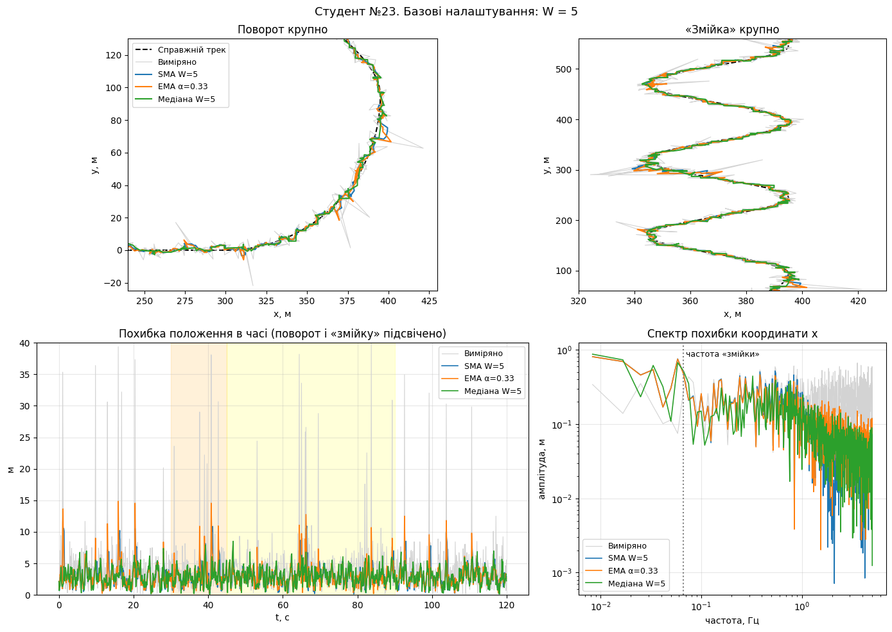
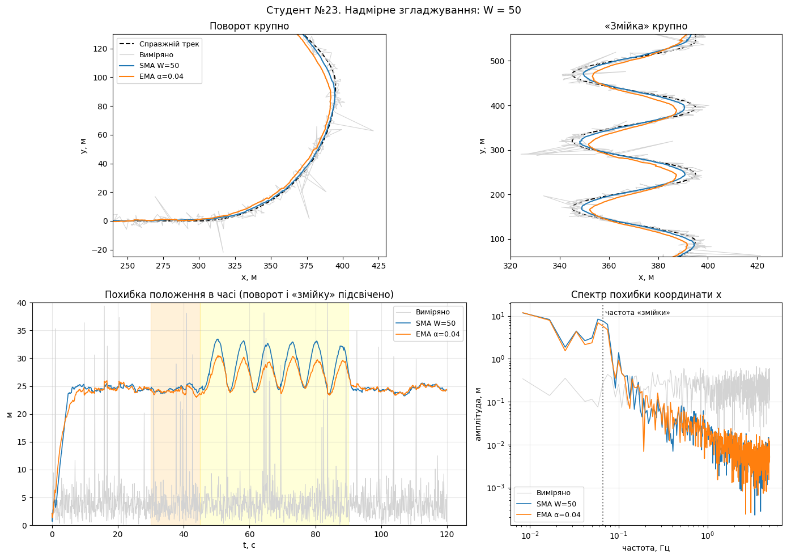
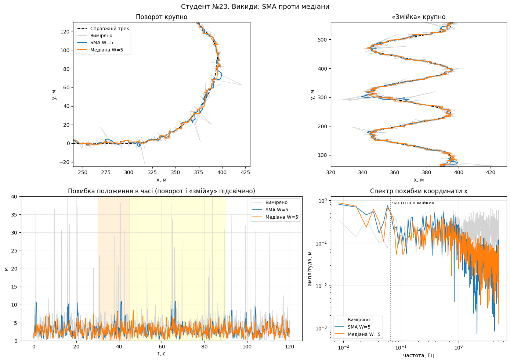
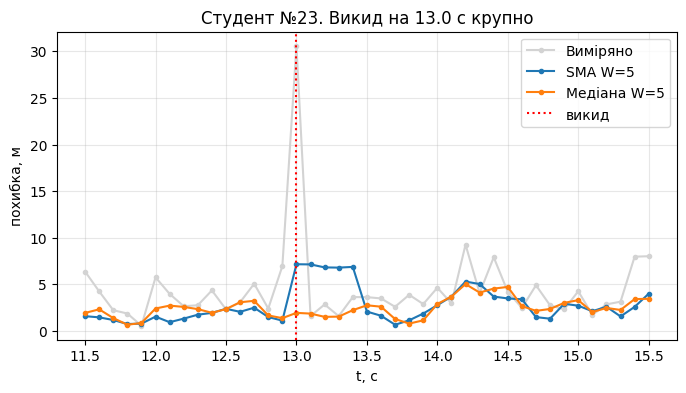
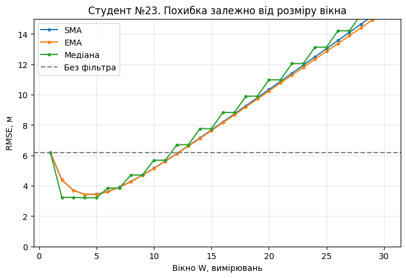
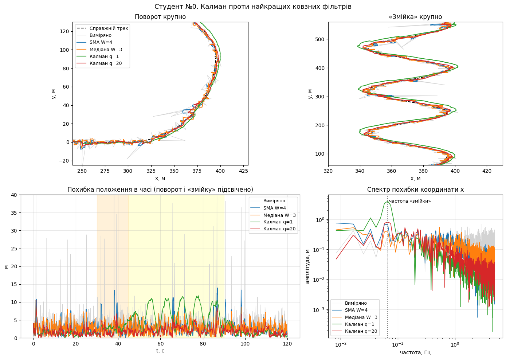
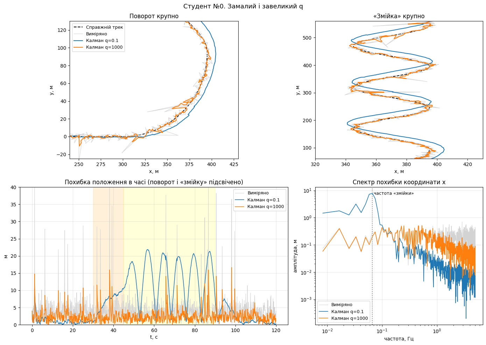
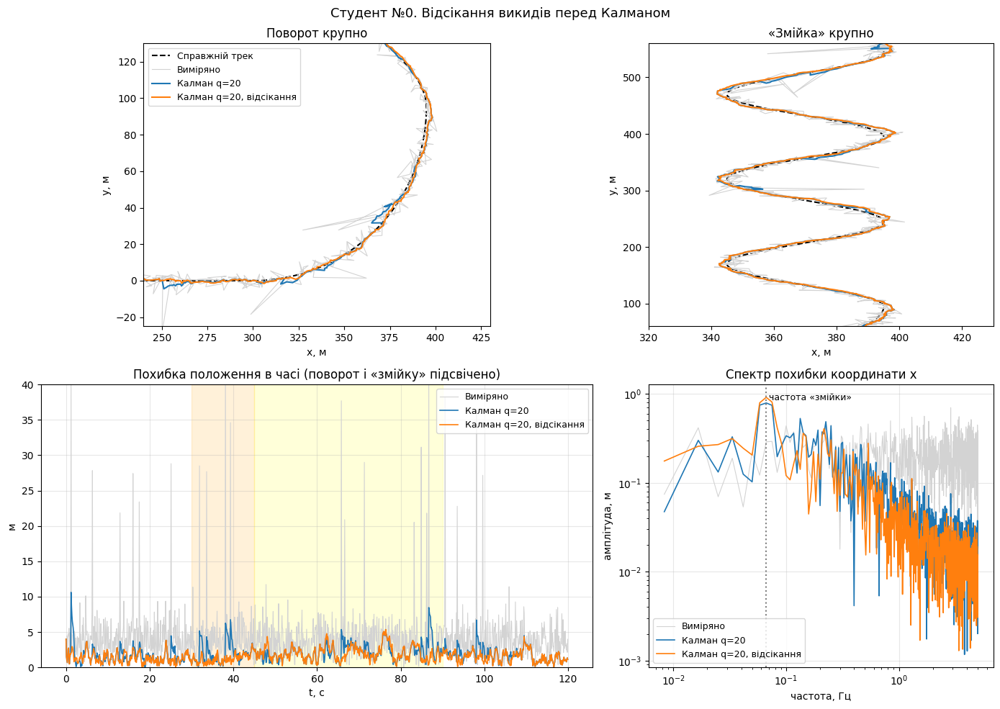

# Звіт до лабораторно-практичного заняття №5
**Придушення шумів у координатних даних: ковзні фільтри, спектр похибки і фільтр Калмана**

**Студент:** №23

---

## Частина 1. Ковзні фільтри і спектр похибки

### Експеримент 1. Базові налаштування
**Таблиця 1. Порівняння базових фільтрів (W = 5)**

| Фільтр | RMSE, м |
| :--- | :--- |
| Виміряно (без фільтра) | 6.20 |
| SMA W=5 | 3.44 |
| EMA α=0.33 | 3.43 |
| Медіана W=5 | 3.21 |

**Відповідь на питання:**
SMA і EMA з $\alpha = 2/(W+1)$ дають майже однаковий результат, оскільки при такому виборі коефіцієнта $\alpha$ вони мають однакову ефективну затримку (центр мас вагової функції) та однакову ефективну смугу пропускання частот. Незважаючи на різний алгоритм розрахунку, їхня здатність придушувати шум і їхня динамічна похибка збігаються.

---

### Експеримент 2. Надмірне згладжування
**Відповіді на питання:**
1. **Затримка:** Відставання вздовж треку розраховується за формулою $\Delta = v \cdot \frac{W-1}{2 f_s}$. При швидкості $v = 10$ м/с, вікні $W = 50$ та $f_s = 10$ Гц: 
   $\Delta = 10 \cdot \frac{49}{20} = 24.5$ м. Це значення повністю збігається з похибкою на прямих ділянках з графіка (≈ 25 м), оскільки там похибка зумовлена виключно запізненням фільтра вздовж осі руху.
2. **Чому похибка зросла:** Надмірне згладжування призвело до величезної динамічної похибки (фільтр "відстає" від об'єкта та "зрізає" маневри). У спектрі похибки права частина (високі частоти) показує ефективне придушення шуму (фільтрована лінія значно нижча за сирі дані). Ліва частина спектра (низькі частоти) відображає сам корисний маневр об'єкта; вона піднялася вище сірої лінії, оскільки фільтр сильно спотворює корисний сигнал (рух), вносячи власну похибку, яка перевищує початковий вимірювальний шум.

---

### Експеримент 3. Викиди
**Таблиця 2. Реакція фільтрів на викиди**

| Дані | Найбільша похибка, м | Момент, с |
| :--- | :--- | :--- |
| Виміряно | 40.3 | 83.7 |
| SMA W=5 | 10.9 | 66.4 |
| Медіана W=5 | 8.5 | 46.7 |

**Відповіді на питання:**
1. **Реакція на викид:** SMA розмазує викид, оскільки він просто додає аномальне значення до суми вікна; у результаті замість одного вузького піку ми отримуємо горб висотою $\text{Викид}/W$, який триває $W$ тактів. Медіана ж сортує значення у вікні: поодинокий викид опиняється з краю відсортованого масиву і відкидається, а результатом стає одне з нормальних значень.
2. **Скільки проковтує медіана:** Як показує тест, медіана з вікном $W=5$ "проковтує" 1 та 2 викиди поспіль (результат 0 м), але пропускає 3 викиди (результат 30 м). Загальне правило: медіанний фільтр з вікном $W$ повністю ігнорує до $\frac{W-1}{2}$ викидів поспіль (оскільки для спотворення результату аномальні значення мають захопити більшість вікна).




---

### Експеримент 4. Оптимальне вікно
**Таблиця 3. Оптимальний розмір вікна для різних фільтрів**

| Фільтр | Найкраще W | Найменша RMSE, м |
| :--- | :--- | :--- |
| SMA | 4 | 3.44 |
| EMA | 5 | 3.43 |
| Медіана | 5 | 3.21 |

**Відповіді на питання:**
Оптимальне вікно таке мале через високу швидкість об'єкта та наявність маневрів. Похибка є сумою двох складових: шуму (спадає як $\sim 1/\sqrt{W}$) та динамічної затримки (зростає лінійно з $W$). Якби об'єкт рухався повільніше або шум був би більшим, точка балансу (мінімум RMSE) змістилася б праворуч — оптимальне вікно стало б більшим.

---

## Частина 2. Фільтр Калмана

### Експеримент 5. Калман проти найкращих ковзних фільтрів
**Відповіді на питання:**
1. **Робота на прямих ділянках:** Фільтр Калмана не відстає на прямій, оскільки його стан містить швидкості ($v_x, v_y$). Фільтр "екстраполює" положення вперед, тому для рівномірного руху затримка відсутня. При $q=1$ фільтр на прямій точніший, ніж при $q=20$, тому що мале $q$ означає високу довіру до моделі рівномірного прямолінійного руху, і фільтр максимально пригнічує вимірювальний шум.
2. **Поведінка при q=1 на маневрах:** Через надмірну "довіру" до моделі рівномірного руху (мале $q$), фільтр стає надто "інерційним" і запізнюється за зміною швидкості (виносить назовні на повороті, проскакує вершини "змійки"). У спектрі похибки на низьких частотах (де зосереджені маневри) його лінія підіймається вище за сирі вимірювання — це дуже схоже на Експеримент 2 з надмірним згладжуванням (SMA W=50). Фільтр Калмана з оптимальним $q=20$ натомість перемагає у всьому діапазоні спектра.

---

### Експеримент 6. Налаштування q
Найкраще $q \approx 17.8$ (RMSE 2.24 м).

**Відповіді на питання:**
1. **Обчислення прискорення:**
   - Поворот: $a_{поворот} = v^2/R = 10^2 / 95 \approx 1.05$ м/с².
   - Змійка (період $P=15$ с, амплітуда $A=25$ м): $a_{змійка} = A (2\pi / P)^2 = 25 \cdot (2\pi / 15)^2 \approx 4.39$ м/с².
   - Квадрат більшого прискорення: $4.39^2 \approx 19.2$ (м/с²)². Це значення дуже близьке до експериментально підібраного найкращого $q \approx 17.8$.
2. **Симптоми неправильного q:**
   - Замалий $q$ (наприклад, 0.1): фільтр ігнорує маневри, "вилітає" на поворотах, іде по дотичній.
   - Завеликий $q$ (наприклад, 1000): лінія сильно тремтить, повністю повторюючи високочастотний шум вимірювань.
   Якби справжній трек був невідомий, $q$ варто було б налаштовувати, зменшуючи його доти, поки згладжений трек не почне "зрізати" кути та помітно "проковзувати" повз інтуїтивні криві реального руху.
3. **Чому Калман із завеликим q кращий за SMA:** Навіть при $q=1000$ RMSE становить 3.16 м, що краще за SMA W=4 (3.44 м), тому що Калман не вносить сталої динамічної затримки на прямих ділянках, як це роблять ковзні фільтри.

---

### Експеримент 7. Викиди і відсікання
**Відповіді на питання:**
1. **Вплив відсікання:** З правильним $q=20$ відсікання ідентифікує аномальні інновації (стрибки) і блокує їх. Без відсікання викид "отруює" стан фільтра, збиваючи як координату, так і оцінку швидкості на кілька наступних тактів.
2. **Статистика відкидання ($q=20$):** Відкинуто 15 нормальних вимірювань, що становить 1.3%. Це дуже близько до теоретичної частки для порогу Махаланобіса $D=3$ у двовимірному просторі (близько 1.1%). Найчастіше нормальні вимірювання хибно відкидаються на піках маневрів (входи/виходи з поворотів), де інновація збільшується через прискорення об'єкта.
3. **Втрата треку при $q=0.5$:** Через мале $q$ фільтр занадто вірить моделі прямолінійного руху. На 43.1 с (момент виходу з крутого повороту і початку переходу на змійку) реальний об'єкт різко маневрує, а прогноз фільтра "їде прямо". Розбіжність стає такою великою, що фільтр вважає *всі наступні правильні вимірювання викидами* і відкидає їх (аж 67.8% відкинуто). Трек втрачається, бо фільтр летить за сліпим прогнозом. **Правило:** налаштовувати коваріацію процесу $q$ потрібно *до* увімкнення відсікання викидів.

---

### Зведена таблиця частини 2

| Фільтр | RMSE, м |
| :--- | :--- |
| Виміряно | 5.81 |
| SMA W=4 | 3.44 |
| Медіана W=3 | 3.20 |
| Калман q=0.1 | 9.77 |
| Калман q=1 | 4.85 |
| Калман q=17.8 (Найкращий) | 2.24 |
| Калман q=20 | 2.23 |
| Калман q=1000 | 3.16 |
| Калман q=20 + відсікання | 1.86 |
| Калман q=0.5 + відсікання | 258.39 |

---

### Загальний висновок
**Прості ковзні фільтри (SMA, Медіана)** є достатніми для повільно рухомих об'єктів з малим вимірювальним шумом, де динамічна затримка, що вноситься вікном, не є критичною. Медіана чудово підходить як перший грубий етап очищення від викидів.

**Фільтр Калмана** є необхідним для динамічних об'єктів з високою швидкістю та маневрами. Завдяки наявності кінематичної моделі (змінних швидкості), він здатен екстраполювати рух без затримок на прямих ділянках, чого ковзні фільтри робити не вміють в принципі. 

Проте **жоден базовий лінійний фільтр (ні SMA, ні Калман) не захищений від нелінійних аномалій — викидів**. Викиди зсувають середні показники та "отруюють" оцінку швидкості в Калмані. Тому обов'язковим є використання окремих механізмів захисту: або нелінійної попередньої фільтрації (Медіана), або статистичного відсікання інновацій (gating / відстань Махаланобіса) безпосередньо у циклі Калмана.
```eof